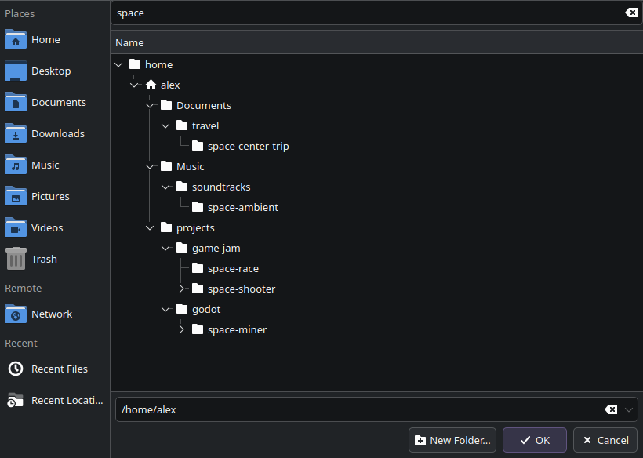

# kfilefilter

A type-to-filter box for KDE's file and folder dialogs. Type a few letters and
the folder tree keeps only what matches, plus the folders that lead to it,
opened up so the matches are in view.



KDE has two dialogs and both get the box: the file dialog (`KFileWidget`, from
KIO) and the "Select folder" dialog (`KDirSelectDialog`, from
plasma-integration), which is what an app gets when it asks for a folder.

It is not a patch to KDE. It is a small library that is loaded into the
process that draws the dialog and adds the box from the outside, so:

- nothing under `/usr` is touched, and a KIO, Plasma or portal update does not
  remove it;
- it uses only public Qt API and reaches the KDE classes by name, so it does not
  break when KIO changes version. A rebuild is needed only for a new major Qt;
- if KDE ever reshapes the dialog so the box has nowhere to go, the dialog
  opens as usual, without the filter.

## What it covers

Every dialog opened through the XDG portal: Electron apps, Flatpaks, Firefox,
Chromium and GTK apps on Plasma. Native KDE apps (Kate, Krita, Dolphin...) draw
the dialog inside their own process and are not hooked by the installer; to try
it in one, start it with `LD_PRELOAD=~/.local/lib/kfilefilter/kfilefilter.so`.

## Using it

- Type anywhere in the file list, or press **Ctrl+F**, and the filter takes the
  letters. Matching is a case-insensitive substring of the name.
- **Enter** or **Down** in the box jumps to the first match.
- **Esc** clears the filter; a second Esc closes the dialog as usual.
- **Backspace** in the list edits the filter.

The tree only knows the folders that have been opened, so while the filter is
active it lists the subtree ahead of you, five levels deep and at most 3000
folders. It starts at the folder the dialog shows, or at your home folder when
the tree hangs from `/`, as the folder dialog's does. `node_modules`, `target`, `__pycache__`, `.git`,
`.venv` and `venv` are not entered.

## Install

Needs CMake and the Qt 6 development files (`qt6-base-dev` on Debian/Ubuntu).

```sh
./install.sh
```

It builds the library, copies it to `~/.local/lib/kfilefilter/` and adds a
systemd drop-in, `~/.config/systemd/user/plasma-xdg-desktop-portal-kde.service.d/kfilefilter.conf`,
that preloads it into the portal. `./uninstall.sh` removes both.

## Settings

Environment variables, added as extra `Environment=` lines to the drop-in:

| Variable | Default | Meaning |
|---|---|---|
| `KFILEFILTER_DEPTH` | `5` | Levels below the current folder that are listed ahead |
| `KFILEFILTER_MAX_DIRS` | `3000` | Folders listed per filter session at most |
| `KFILEFILTER_SKIP` | `node_modules,target,__pycache__,.git,.venv,venv` | Folder names never entered |
| `KFILEFILTER_DISABLE` | unset | Set to anything to load without adding the box |

After editing the drop-in run
`systemctl --user daemon-reload && systemctl --user restart plasma-xdg-desktop-portal-kde`.

## Smoke test

`tests/smoke.cpp` opens a real dialog (`file` for `KFileWidget` in tree view,
`dir` for `KDirSelectDialog`), types into the box and saves a screenshot. It needs the KF6 KIO headers (`libkf6kio-dev`).

```sh
cmake -S . -B build -DBUILD_SMOKE_TEST=ON
cmake --build build
LD_PRELOAD=$PWD/build/kfilefilter.so build/smoke dir ~ dxleg shot.png
```

It exits with 1 when the box is missing, so running it without `LD_PRELOAD`
must fail.

Tested on Kubuntu with KDE Frameworks 6.24, Plasma 6.6 and Qt 6.10, on Wayland.
